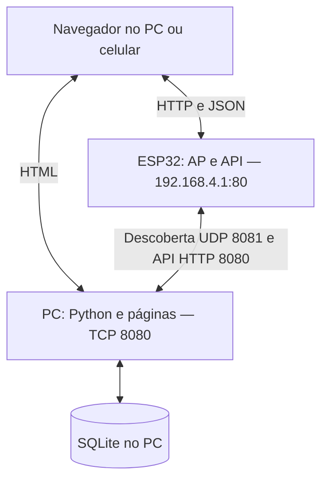

# Arquitetura e funcionamento

## Lógica de venda

O firmware C usa ESP-IDF e FreeRTOS. A API HTTP recebe JSON e valida o token
Bearer no servidor Python antes de aceitar um pedido de uma a três unidades,
distribuídas entre seis sabores. O controlador verifica estoque, manutenção,
pedido em andamento e venda pendente. Autenticação não representa pagamento.

Uma máquina de estados coordena a entrega. `RECEBIDO` agenda a unidade;
`EMITINDO` prepara o IR; `LIBERANDO` acompanha acionamento e confirmação;
`INTERVALO_REPETICAO` agenda outra tentativa; `ENTREGUE` indica conclusão.
Os estados internos de preparo e repetição são publicados como `recebido`
para manter compatibilidade com a interface. `ERRO` indica interrupções como
manutenção, e `OCIOSO` representa partida ou cancelamento.

O mutex do controlador protege o estado compartilhado. A tarefa de controle
cede a CPU por um tick entre ciclos; o desligamento do motor usa tempo decorrido,
sem esperar três segundos em uma chamada bloqueante. A tarefa de sincronização
faz HTTP fora desse mutex e tenta enviar a venda e o estoque a cada ciclo de
cinco segundos, acrescido do tempo das requisições.

A baixa de estoque acontece por unidade confirmada. A venda completa é salva
na NVS antes do envio ao SQLite; o identificador de evento permite deduplicação
no servidor. Novos pedidos aguardam a confirmação da pendência. Pedidos
interrompidos não são reconstruídos após reiniciar; entregas parciais não geram
uma venda parcial. Algumas falhas de escrita de estoque não são propagadas pela
implementação atual: persistência local não equivale a uma transação atômica de
todo o pedido.

## Rede

O ESP32 cria o AP `COOKIE_EXPRESS`, com WPA2, canal 11, largura de 20 MHz e até
quatro clientes. A API opera em `192.168.4.1:80`; o PC hospeda as páginas e o
backend na porta 8080. O navegador carrega HTML do PC e chama a API do ESP.
Essa rede local não fornece internet.

A descoberta do PC usa broadcast UDP com nonce e HMAC-SHA256. A chave privada
também identifica o ESP nas requisições HTTP, mas não é entregue ao navegador.
O protocolo HTTP atual não usa TLS. O endereço do PC é descoberto novamente
após falhas de transporte; não precisa ser fixado no firmware.

## Integração de pagamento

O projeto ainda não integra um provedor de pagamento. Uma implementação futura
deverá criar a cobrança no backend, relacionar transação e pedido, validar a
confirmação do provedor e autorizar a entrega somente após aprovação. Será
necessário tratar notificações duplicadas com idempotência e definir o fluxo de
cancelamento, expiração e estorno em caso de entrega incompleta. Credenciais do
provedor devem permanecer no servidor.

## Controle do mecanismo

`acionamento.c` configura os GPIOs 18, 19, 21, 22, 23 e 25 como saídas para os
drivers dos motores. Antes de ligar um compartimento, força todas as saídas a
LOW e verifica a chave da porta. Somente o motor escolhido recebe HIGH; o GPIO
comanda o circuito de potência, sem alimentar o motor diretamente.

O emissor IR no GPIO26 usa LEDC com portadora de 38 kHz e duty de 50%, em
rajadas de 100 ms seguidas de pausas de 100 ms. O preparo começa um segundo
antes do motor. O receptor no GPIO27 combina interrupções de borda e amostragem
na tarefa de controle para reconhecer livre → bloqueado → livre. Cada etapa
exige estabilidade de 2 ms; a captura ignora o primeiro milissegundo da rajada.
Uma sequência incompleta é descartada na pausa; uma passagem válida fica retida.

O motor funciona por pelo menos três segundos, até a tarefa observar o prazo.
A passagem pode ser detectada durante o movimento, mas a confirmação só ocorre
depois da parada. Sem confirmação, o sistema espera três segundos após parar e
agenda outra tentativa com intervalo nominal de dois segundos, incluindo o
preparo do emissor. São três tentativas no total; depois, continua aguardando
confirmação, sem timeout automático de erro do IR.

GPIO32 em LOW indica porta aberta. O controlador desliga os motores, encerra
a observação IR, interrompe o pedido e persiste a manutenção. Fechar a porta
libera automaticamente a manutenção se não houver falha de persistência, sem
retomar o pedido anterior. Trata-se de intertravamento por software.

Na configuração atual, `MODO_TESTE_SERIAL=0` habilita a confirmação física e
`BOOT_CONFIRMA_TESTE=1` permite confirmação manual no GPIO0 após a parada.
`D` exige modo serial ativo; `R` cancela e `S` mostra diagnóstico. Os comandos
de teste participam do firmware real e podem alterar estoque e gerar vendas.

## Leitura e validação

Os comentários dos módulos explicam contratos, propriedade dos objetos JSON,
sincronização, temporização e condições de bloqueio. O
[guia offline](guia_projeto.html) inclui os fontes públicos comentados; execute
`servidor/docs/atualizar_guia.py` após alterar o firmware para atualizar os trechos.
Consulte [os testes disponíveis](../testes/README.md). Compilação e testes
simulados não comprovam o comportamento elétrico e mecânico da instalação.
