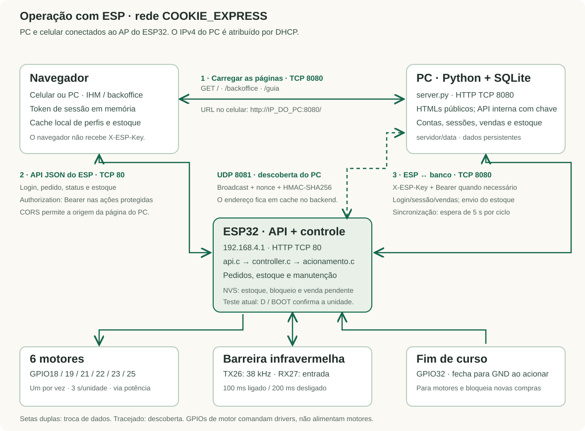
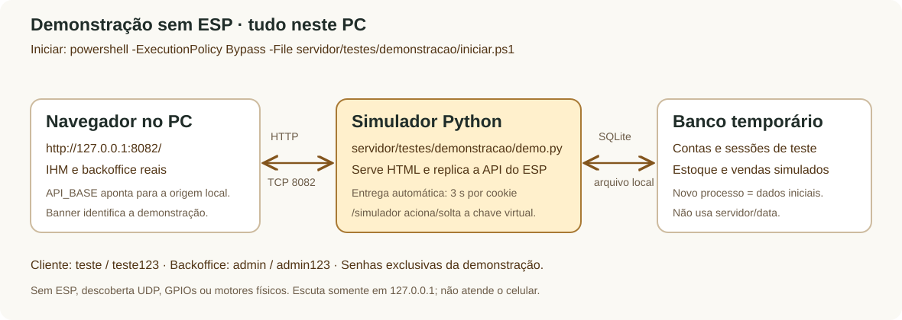

# Comunicação atual do Cookie Express

Diagramas e explicações também estão no [guia HTML](guia_projeto.html#comunicacao),
que funciona offline e incorpora as figuras em SVG.

## Com a máquina ESP32

1. PC e celular entram no AP `COOKIE_EXPRESS`, criado pelo ESP (`192.168.4.1`).
   O navegador baixa IHM/backoffice do Python em `http://IP_DO_PC:8080/`.
   No próprio PC, pode usar `http://127.0.0.1:8080/`.
2. Os HTMLs chamam diretamente `http://192.168.4.1/api/*`. Cadastro, login,
   sessão e vendas passam pelo ESP até o Python. Pedidos e estoque físico
   são controlados no ESP; acompanhamento usa o token do pedido atual.
3. `backend.c` descobre o PC por broadcast UDP em `192.168.4.255:8081`.
   O Python responde ao nonce com porta HTTP e assinatura HMAC-SHA256.
   O ESP valida e guarda o endereço em cache, redescobrindo após falha.
4. A API interna Python exige `X-ESP-Key`; ações do usuário também levam
   `Authorization: Bearer`. A chave de máquina fica fora dos HTMLs.
5. O ESP confirma unidades, baixa estoque e salva na NVS. Ao concluir o pedido,
   persiste uma venda pendente; a tarefa de banco envia `POST /api/vendas` e
   `PUT /api/estoque`, esperando 5 segundos entre ciclos. SQLite deduplica a venda
   pelo evento. O estoque do PC é uma cópia, não comanda o estoque físico.
6. Motores e sensores usam GPIO, sem tráfego HTTP entre eles e o ESP. Os seis
   motores são sequenciais. GPIO32 fecha para GND, interrompe o pedido e mantém
   manutenção até liberação administrativa após soltar a chave.

No firmware atual, `MODO_TESTE_SERIAL=1`: D/BOOT confirma cada unidade após o
pulso do motor. O IR continua emitindo em 38 kHz, 100 ms ligado / 200 ms desligado,
para diagnóstico. No modo `0`, a lógica do IR assume a confirmação de entrega.
O código documenta o estado dos fontes; a placa só passa a usá-lo após gravação.

## Demonstração local sem ESP

Execute `servidor/testes/demonstracao/iniciar.ps1` e abra <http://127.0.0.1:8082/>.
O navegador baixa as telas e usa a API no mesmo processo Python local.
O simulador reutiliza as classes de HTTP/autenticação/SQLite do servidor, com
um banco temporário e contas exclusivas. Não faz descoberta UDP, não acessa
o ESP e não altera `servidor/data`.

O relógio do simulador entrega uma unidade a cada 3 segundos, com baixa de
estoque e registro da venda ao concluir. `/simulador` controla a chave virtual;
soltá-la mantém o bloqueio até confirmação no backoffice. Novo processo recria
os dados iniciais. O servidor real em 8080 continua independente.

Veja [comandos e organização dos testes](../testes/README.md) e
[pinagem e manutenção](placa_motores_manutencao.md).
